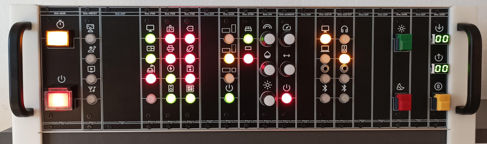
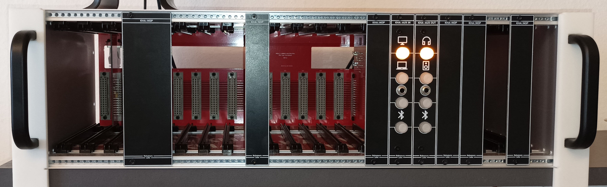
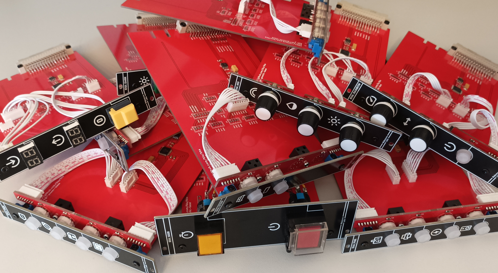
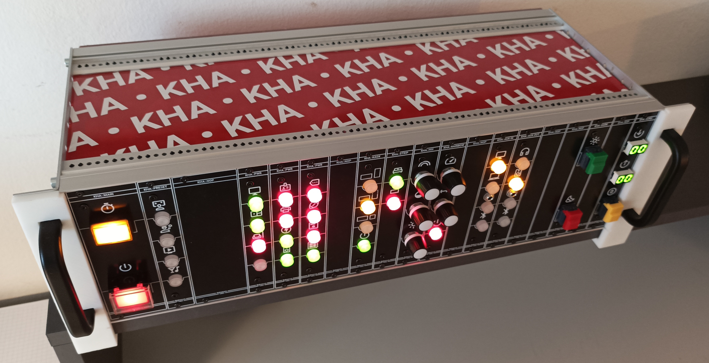
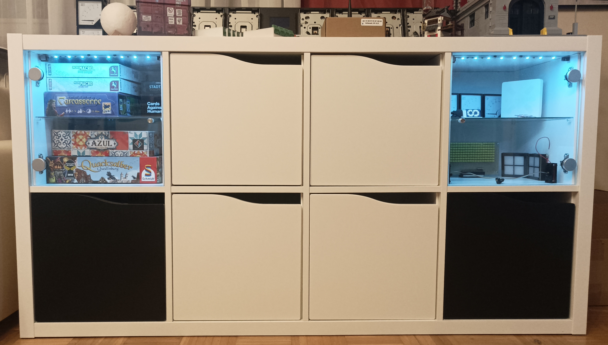
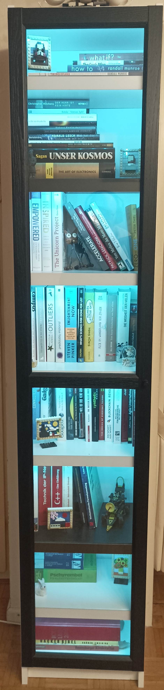
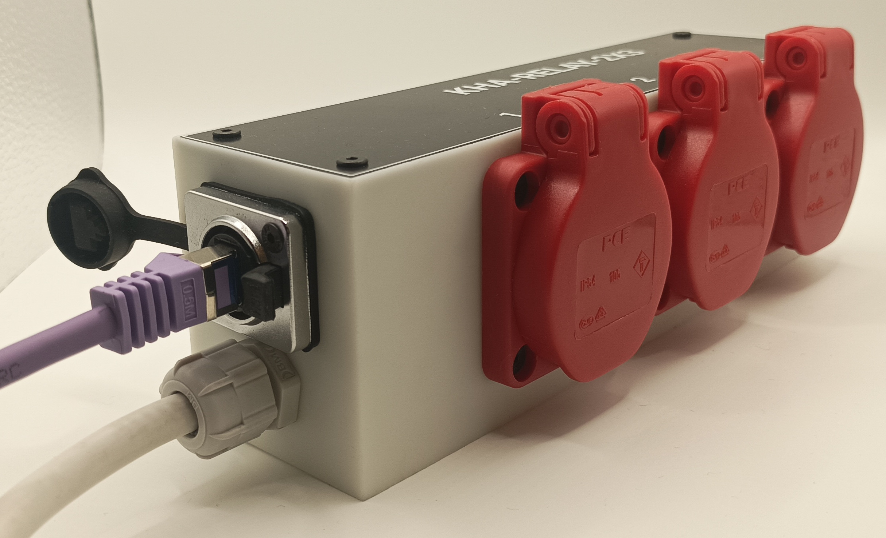

# kha

Overengineered Modular RS-485 Multi-Master 19" Subrack Home Control



## Repository

<sup>Hint: "bgt" is German for [Baugruppenträger](https://de.wikipedia.org/wiki/Baugruppentr%C3%A4ger) translating to subrack assembly</sup>

- [datasheets](datasheets/): Datasheets of used components and rack dimensions / layouts
- [kha-bgt-misc](kha-bgt-misc/): Generic subrack modules
- [kha-bgt-rack](kha-bgt-rack/): 19" rack assembly
- [kha-bgt-subrack](kha-bgt-subrack/): Subrack modules
- [kha-boot.X](kha-boot.X/): Bootloader used by all devices ([main.c](kha-boot.X/main.c))
- [kha-common.X](kha-common.X/): Protocol stack used by all devices ([kha-stack.c](kha-common.X/kha-stack.c) / [kha-stack.h](kha-common.X/kha-stack.h) / [kha-constants.h](kha-common.X/kha-constants.h))
- [kha-nodes](kha-nodes/): Bus nodes
- [superseded](superseded/): Superseded ideas and failed hardware revisions
- [tools](tools/): Helper scripts to e.g. generate userrow data
- [kha-bom-collection.pdf](kha-bom-collection.pdf) / [.ods](kha-bom-collection.ods): Not exactly a Bill-of-Materials rather a collection of most components used
- [kha-protocol.pdf](kha-protocol.pdf) / [.ods](kha-protocol.ods): Protocol stack definitions

## Protocol

RS-485 at 500 kbaud (8N1), half duplex, every node may send. Commands, addresses and registers are listed in
[kha-protocol.ods](kha-protocol.ods).

### Frame

```
0x42 0x99 <len> <from> <to> <cmd> <payload ...> <crc>
```

- `0x42 0x99` starts a frame. Inside a frame every `0x42` is followed by an extra `0x66`, so `0x42 0x99` is
  always a start. The escape bytes are not counted and not part of the CRC.
- `len` counts len, from, to, cmd, payload and crc: 5 + payload, payload up to 67 bytes.
- CRC-8 (polynomial 0x31, init 0xFF, no final XOR) over all bytes from `len` to the last byte before the CRC.

### Bus access

- The stack counts 100 µs ticks on TCB2, which is reserved for the stack. Every falling edge on RX resets the
  count.
- A node sends once the bus has been quiet for 10 + its own address ticks (1 ms + address × 100 µs). Addresses
  are unique, so no two nodes wait for the same slot.
- After sending, a node waits once for the longest slot (10 + 0xF0 ticks), so the others get their turn first.
- The bootloader commands F9–FC skip the slot wait to keep flashing fast: send TX off (F0) to the other
  nodes before flashing.

### Firmware

- Flash: bootloader at 0x0000–0x3FFF, app at 0x4000–0xFFFF. At every boot a node computes a CRC-32 over
  0x4000–0xFFFF (without the final XOR) and reports it with the boot and app versions in its UP (E2) and
  ident (E1).
- Bootloader: after a reset it waits 4 s for bootloader commands (FD keeps it there), then starts the app.
  Brown-out detection at 2.85 V. No lock bits, so UPDI can read and write a node.
- Flashing over the bus: [kha_fw.py](tools/kha-scripts/); via UPDI: [kha_updi.py](tools/kha-scripts/).

## Videos
Two hour deep dive lecture style video on youtube: https://youtu.be/BUSnTUGKZzc

<a href="http://www.youtube.com/watch?feature=player_embedded&v=BUSnTUGKZzc" target="_blank">
	
</a>

## Photos













## Misc

- All PCBs use [eAVR](https://github.com/kiu/eAVR/) as connector for AVR flashing
- It all started simple with [lightdesk](https://github.com/kiu/lightdesk/)

## Todo

- Node: LED marquee node
- Node: IrDA bridge (bridging the bus through a window)
- Stack: Combine queued TX commands into single burst?
- Stack: Merge similiar queued TX commands into single command?
- Stack: Process TX commands as incoming RX commands?

## Regrets

- Terrible collision detection / avoidance
- Buck converter capacitor generates audible noise

# License

This project is licensed under the Creative Commons Attribution-NonCommercial 3.0 Unported (CC BY-NC 3.0) license.
