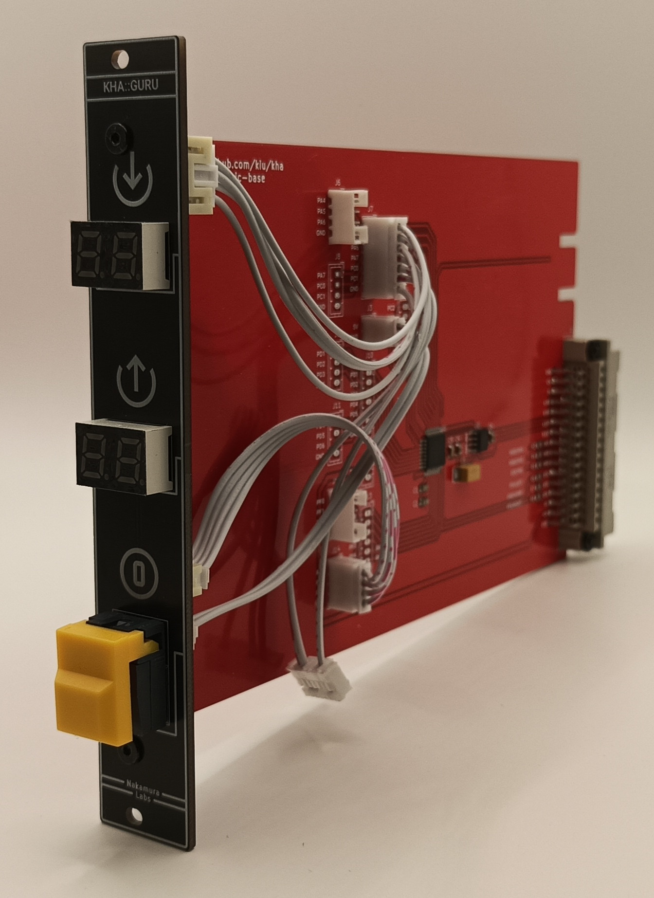

# kha-bgt-guru

Debug Module

Shows the highest error counters reported by the nodes: top display RX errors, bottom display TX
errors (hex, `--` until the first answer).

## Registers

| Register | Value | Behaviour |
|---|---|---|
| 00 | `00` | Sequence: ask every node one by one, no reply storm on the bus |
| 00 | `01`-`EF` | Direct: ask only this node |
| 00 | `F0`-`FF` | Group / broadcast: one request, all nodes in it reply at once |
| 01 | `01`-`FF` | Stats request interval in minutes, `00` = off |

Sequence mode:

- Button: clears the guru and broadcasts STATS CLEAR, then scans all addresses `01`-`EF` at once
  (about 50 s) and remembers which nodes answered.
- Interval: asks only the remembered nodes. After a reboot the list is empty, so the first interval
  does the full scan (nodes may still be in their bootloader right after power-up).
- A node that does not answer twice in a row makes the display blink, until the next button press
  or until the node answers again. Direct mode blinks the same way; group and broadcast never blink.

## Parts

Use [kha-bgt-generic-base](../../kha-bgt-misc/kha-bgt-generic-base/) as base

## Photos

